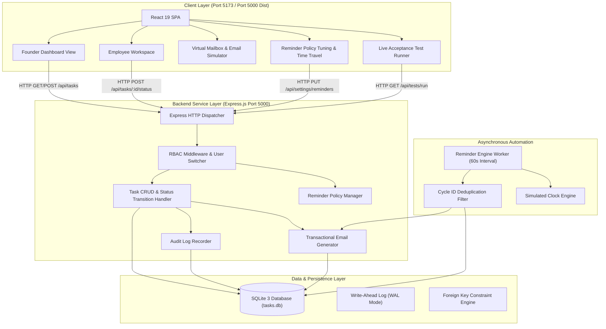
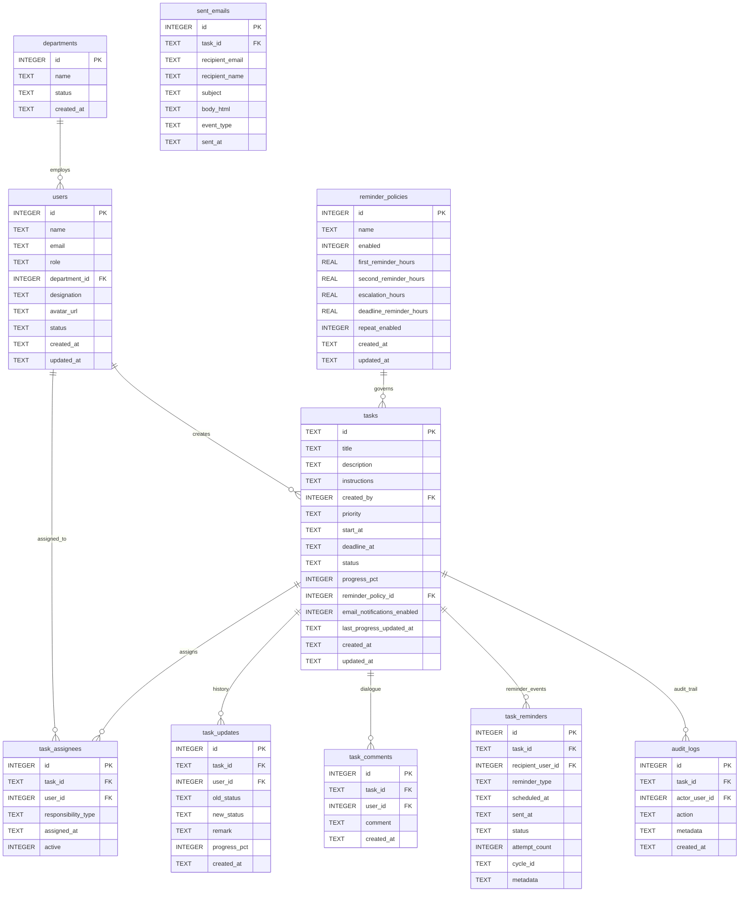

# Founder To-Do Allocation & Follow-Up Dashboard
## Technical Architecture & Implementation Deep-Dive
**Document Version:** 1.0.0  
**Effective Date:** 29 September 2026  

---

## 1. High-Level Architecture Overview

The platform uses a decoupled three-tier architecture comprising a modern React SPA, an Express REST API with native SQLite data access, and an in-process deterministic background worker.



---

## 2. Inactivity Detection & Escalation Sequence

The following sequence details how the background reminder engine evaluates a task, detects assignee inactivity, avoids duplicate emails, and escalates to the founder:

```mermaid
sequenceDiagram
    autonumber
    participant Scheduler as Background Scheduler (60s)
    participant Engine as Reminder Engine
    participant DB as SQLite Database
    participant Mailer as Email Service
    participant Founder as Founder Vikram
    participant Employee as Assignee Rahul

    Scheduler->>Engine: Trigger periodic scan
    Engine->>DB: Query active tasks & policy thresholds
    DB-->>Engine: Return tasks with last_progress_updated_at

    loop For Each Active Task
        Engine->>Engine: Calculate hours_inactive = (EffectiveNow - last_progress_updated_at)
        alt Inactivity >= 24h & < 48h (First Reminder)
            Engine->>Engine: Generate cycle_id: INACT_1_<id>_<last_updated>
            Engine->>DB: Check if cycle_id already recorded
            alt Not yet sent in this cycle
                Engine->>Mailer: Dispatch First Reminder email with deep-link
                Mailer->>Employee: Deliver follow-up notification
                Engine->>DB: Insert record into task_reminders & audit_logs
            else Already sent in this cycle
                Engine->>Engine: Increment skippedDuplicates counter (Idempotent)
            end
        else Inactivity >= 72h (Founder Escalation)
            Engine->>Engine: Generate cycle_id: ESCALATE_<id>_<last_updated>
            Engine->>DB: Check if cycle_id exists
            alt Not yet escalated
                Engine->>Mailer: Dispatch Escalation Alert to Founder & Admin
                Mailer->>Founder: Send urgent escalation email
                Engine->>DB: Record ESCALATION reminder and TASK_ESCALATED audit log
            end
        end
    end

    Employee->>DB: Clicks deep link & submits progress update (status='In Progress', 40%)
    Note over Employee,DB: last_progress_updated_at updated to CURRENT_TIMESTAMP
    Note over Engine,DB: Inactivity timer resets to 0; previous cycles invalidated
```

---

## 3. Database Entity-Relationship Specification



---

## 4. Key Implementation Highlights

### 4.1 Native Synchronous SQLite Engine
The backend eliminates asynchronous callback overhead and third-party compilation hurdles by utilizing Node 22's standard library `node:sqlite DatabaseSync`. All database operations execute predictably in sub-millisecond timeframes.

### 4.2 Deduplication Key Format
Cycle keys prevent duplicate emails during scheduler intervals:
- **First Inactivity Reminder:** `INACT_1_${task.id}_${task.last_progress_updated_at}`
- **Second Inactivity Reminder:** `INACT_2_${task.id}_${task.last_progress_updated_at}`
- **Founder Escalation:** `ESCALATE_${task.id}_${task.last_progress_updated_at}`
- **Deadline Approaching:** `DEADLINE_APPROACHING_${task.id}_${task.deadline_at}`
- **Deadline Overdue:** `DEADLINE_OVERDUE_${task.id}_${task.deadline_at.substring(0, 10)}`

Because the key incorporates the timestamp, any employee update automatically invalidates older keys without manual cleanup queries.

### 4.3 Time Travel Engine for Verification
The `system_config` table persists `simulated_now_offset_hours`. Both API requests and the background scheduler query `getEffectiveNow()` instead of bare system time:
```javascript
function getEffectiveNow() {
  const config = db.prepare('SELECT value FROM system_config WHERE key = ?').get('simulated_now_offset_hours');
  const offsetHours = config ? parseFloat(config.value) || 0 : 0;
  return new Date(Date.now() + offsetHours * 3600 * 1000);
}
```
This guarantees that time adjustments made in the simulation toolbar take immediate effect across all dashboard calculations and automated reminder sweeps.
