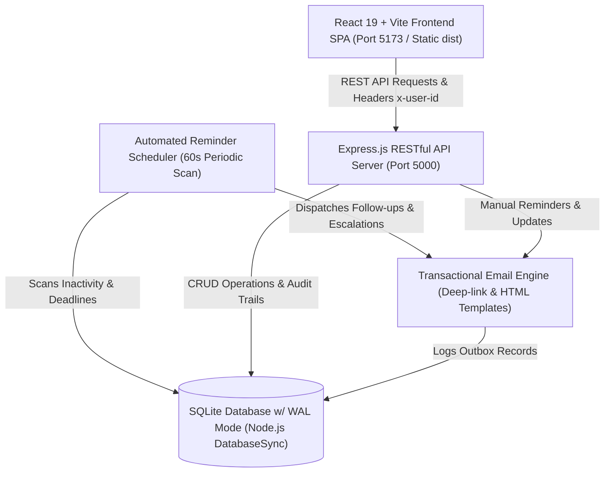
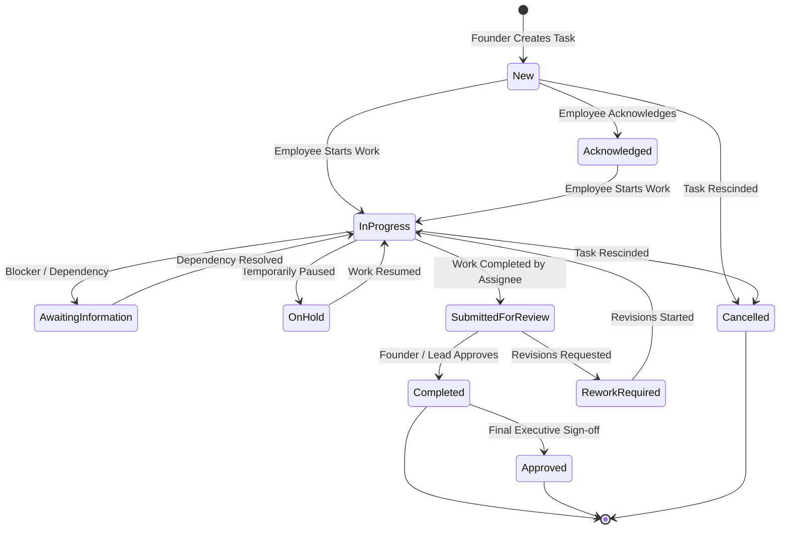
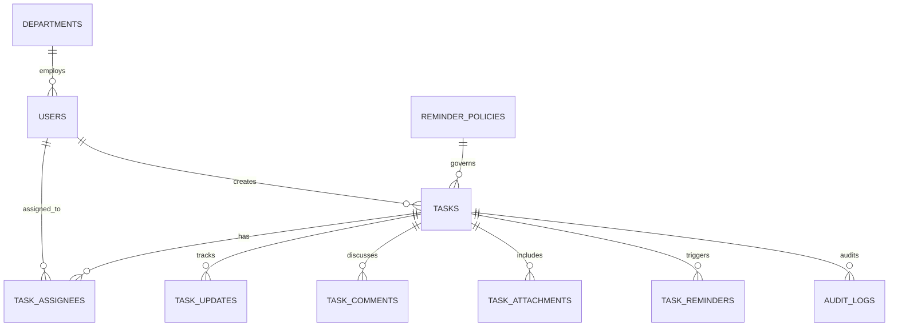

# Founder To-Do Allocation & Follow-Up Dashboard
## Developer-Ready Product & Technical Specification
**Version:** 1.0.0  
**Effective Date:** 29 September 2026  
**Timezone Standard:** Asia/Kolkata (IST, UTC+5:30)  
**System Status:** Operational & Production Ready  

---

## 1. Executive Summary & System Objectives

### 1.1 Context & Problem Statement
In fast-moving founder-led organizations, founders and managing directors allocate dozens of strategic and operational tasks across department heads, engineers, marketers, and HR personnel. When task management relies on disjointed chat messages, emails, or generic kanban boards, three fatal breakdown modes consistently emerge:
1. **The Inactivity Void:** Tasks slip into inactivity without status updates or blocker remarks, remaining invisible until a missed deadline causes acute damage.
2. **Founder Micro-Management Burden:** Founders must manually chase assignees for incremental updates ("Any update on this?"), draining executive focus.
3. **Status Masking:** Systems often overwrite real employee progress with a generic "Overdue" flag or force false "Done" statuses, destroying nuanced delivery tracking.

### 1.2 System Purpose
The **Founder To-Do Allocation & Follow-Up Dashboard** is an internal execution intelligence platform engineered to eliminate follow-up friction. It combines:
- **Founder-Directed Task Allocation:** Direct task delegation with explicit deadlines, priority ratings, contributors, and detailed instructions.
- **Autonomous Follow-Up Engine:** An automated, non-invasive reminder engine that monitors the duration of assignee inactivity, sending escalating nudges (First Reminder &rarr; Second Notice &rarr; Founder Escalation).
- **Dual-Status Integrity:** Preserves the assignee's authentic working status (`In Progress`, `Awaiting Information`, `Submitted for Review`) while dynamically computing SLA, inactivity, and overdue flags.
- **Deep-Linked Email Delivery:** Every notification includes a authenticated, one-click deep link (`/?task=<id>`) taking the employee directly into the task remark modal.
- **Audit-Logged Transparency:** Immutable audit logging for assignments, status transitions, remarks, and reminder notifications.

---

## 2. Target Personas & Core Workflows

| Persona | Role Key | Permissions & Capabilities | Primary Objectives |
| :--- | :--- | :--- | :--- |
| **Founder / Managing Director** | `founder` | Full system access. Create, edit, reassign, cancel, approve tasks. Modify reminder thresholds, trigger manual follow-ups, view all department tasks, and receive SLA escalations. | High-level organizational oversight; eliminate follow-up overhead; zero dropped balls on critical initiatives. |
| **Chief of Staff / Executive Admin** | `admin` | System-wide visibility, operational task management, reminder policy tuning, audit log inspection, simulation control. | Operational continuity; triage bottlenecks before they reach the Founder. |
| **Department Assignees (Employees)** | `employee` | Strictly scoped to tasks where user is assigned as `primary`, `contributor`, or `reviewer`. Update status, log progress percentages, submit remarks, upload attachments, and request clarifications. | Frictionless task acknowledgment, rapid blocker reporting, clear accountability without manual micromanagement. |

---

## 3. System Architecture & Tech Stack



### 3.1 Technology Foundation
- **Backend Runtime:** Node.js (v22+) utilizing native synchronous SQLite engine (`node:sqlite DatabaseSync`) for high-performance zero-dependency database access.
- **Database Engine:** SQLite 3 in Write-Ahead Logging (`PRAGMA journal_mode = WAL;`) and Foreign Key enforcement (`PRAGMA foreign_keys = ON;`).
- **RESTful API Framework:** Express.js with JSON payloads, CORS middleware, file upload staging via Multer, and modular route dispatchers.
- **Frontend SPA:** React 19 bootstrapped with Vite, Lucide React icons, and modern responsive CSS design system (Plus Jakarta Sans and Outfit typography).
- **Background Scheduler:** In-process daemon executing periodic scans every 60 seconds with strict idempotent deduplication cycles.

---

## 4. Task State Machine & Lifecycle Rules

### 4.1 State Hierarchy


### 4.2 Computed Overdue vs. Persistent Status Rule (Section 4 Principle)
> **Fundamental Design Principle:** The system **never** overwrites the functional status (e.g. `In Progress`, `Submitted for Review`) with a static `Overdue` string in the database.
- **Rationale:** Replacing an employee's status with "Overdue" obscures whether work is 80% done, awaiting vendor feedback, or not yet started.
- **Implementation:** The database column `tasks.status` records the actual operational state. The system dynamically computes:
  $$\text{is\_overdue} = (\text{status} \notin \{\text{'Completed'}, \text{'Approved'}, \text{'Cancelled'}\}) \land (\text{effective\_now} > \text{deadline\_at})$$
  This flag is appended dynamically to API responses and triggers overdue styling and alert badges on the UI.

---

## 5. Inactivity Tracking & Dynamic Reminder Policy Engine

### 5.1 Inactivity Timer Definition
Inactivity is calculated as the elapsed time since the assignee last logged an authentic progress update:
$$\text{Hours Inactive} = \frac{\text{Effective Now} - \text{last\_progress\_updated\_at}}{3,600,000 \text{ ms}}$$

### 5.2 Dynamic Policy Thresholds
The platform supports configurable reminder policies stored in the `reminder_policies` table:
- **Standard Founder Policy:** First reminder at **24h**, second reminder at **48h**, founder escalation at **72h**, deadline alert at **12h**.
- **Urgent / High-Velocity Policy:** First reminder at **6h**, second reminder at **12h**, founder escalation at **24h**, deadline alert at **4h**.
- **Relaxed Executive Policy:** First reminder at **48h**, second reminder at **96h**, founder escalation at **144h**, deadline alert at **24h**.

### 5.3 Inactivity Notification Matrix
| Phase | Condition | Recipient | Action / Notification | Cycle ID Hash |
| :--- | :--- | :--- | :--- | :--- |
| **First Reminder** | $\text{Hours Inactive} \ge T_1$ | Primary Assignee | Follow-up Alert: Inactivity prompt with direct task link | `INACT_1_<task_id>_<last_updated>` |
| **Second Notice** | $\text{Hours Inactive} \ge T_2$ | Primary Assignee | Second Notice: Impending escalation warning | `INACT_2_<task_id>_<last_updated>` |
| **Escalation** | $\text{Hours Inactive} \ge T_3$ | Founder & Admin | ESCALATION ALERT: Managerial intervention required | `ESCALATE_<task_id>_<last_updated>` |
| **Deadline Warning** | $\text{Hours Remaining} \le T_D$ | Primary Assignee | Deadline Approaching notice | `DEADLINE_NEAR_<task_id>_<deadline>` |
| **Deadline Overdue** | $\text{Effective Now} > \text{Deadline}$ | Assignee & Founder | Urgent Overdue Alert | `OVERDUE_<task_id>_<deadline_day>` |

### 5.4 Deduplication & Inactivity Reset Mechanism
1. **Cycle ID Idempotency:** Every notification computes a deterministic `cycle_id` keyed to the `last_progress_updated_at` timestamp. If an automated scan runs 1,000 times while a task remains inactive, the scheduler checks `task_reminders` for that `cycle_id` and skips duplicate dispatches.
2. **Inactivity Reset:** When an assignee submits a progress update, remark, or status change, `last_progress_updated_at` is set to `CURRENT_TIMESTAMP`. This immediately invalidates the previous cycle and resets the inactivity timer to zero.

---

## 6. Security, Role-Based Access Control (RBAC) & Data Privacy Rules

### 6.1 Access Permissions Matrix
```
+------------------------------------+---------+-------+----------+
| Capability                         | Founder | Admin | Employee |
+------------------------------------+---------+-------+----------+
| View All Company Tasks             |   YES   |  YES  |    NO    |
| View Assigned Tasks                |   YES   |  YES  |   YES    |
| Create New Tasks                   |   YES   |  YES  |    NO    |
| Edit Title, Deadline, Priority     |   YES   |  YES  |    NO    |
| Reassign Tasks                     |   YES   |  YES  |    NO    |
| Update Progress & Add Remarks      |   YES   |  YES  |   YES*   |
| View Full Audit Trail              |   YES   |  YES  |    NO    |
| Configure Reminder Policies        |   YES   |  YES  |    NO    |
| Send Manual Follow-Up Nudges       |   YES   |  YES  |    NO    |
| Run Time-Travel Simulations        |   YES   |  YES  |    NO    |
+------------------------------------+---------+-------+----------+
* Employees may only update tasks they are actively assigned to.
```

### 6.2 Data Privacy Implementation
- Any request by an `employee` to `/api/tasks/:id` verifies active record in `task_assignees`:
  ```sql
  SELECT id FROM task_assignees WHERE task_id = ? AND user_id = ? AND active = 1
  ```
  If absent, the API terminates immediately with `HTTP 403 Forbidden` (`{"success": false, "error": "Access denied: You are not assigned to this task"}`).

---

## 7. Relational Data Model & SQLite Schema



### 7.1 Schema Summary
- **`departments`**: Organizational departments (Engineering, Talent, Marketing, Executive).
- **`users`**: User identity, roles (`founder`, `admin`, `employee`), designations, avatars.
- **`reminder_policies`**: Dynamic hourly thresholds for first reminder, second notice, escalation, and deadline warnings.
- **`tasks`**: Task core entity with start dates, deadlines, operational statuses, priority, policy associations, and last progress timestamps.
- **`task_assignees`**: Junction table supporting multiple assignees with responsibility types (`primary`, `contributor`, `reviewer`).
- **`task_updates`**: Immutable log of progress percentage shifts, state transitions, and required employee remarks.
- **`task_comments`**: Collaboration dialogue between founder and assignees.
- **`task_reminders`**: Sent reminder log recording timestamp, recipient, cycle key, and delivery status.
- **`sent_emails`**: Virtual mailbox storing generated HTML emails, template keys, and deep links.
- **`audit_logs`**: System-wide immutable security and event audit trail.

---

## 8. RESTful API Specifications

| Method | Endpoint | Description | Auth / Role |
| :--- | :--- | :--- | :--- |
| `GET` | `/api/health` | Service health and engine status | Public |
| `GET` | `/api/dashboard` | Aggregated executive KPIs, active alerts, priority counters | Founder / Admin |
| `GET` | `/api/tasks` | Filtered task list (`status`, `priority`, `assignee`, `overdue`, `no_update`) | Role-Scoped |
| `POST` | `/api/tasks` | Create new allocated task with assignees | Founder / Admin |
| `GET` | `/api/tasks/:id` | Detailed task view with assignees, updates, and attachments | Role-Scoped |
| `PUT` | `/api/tasks/:id` | Update task core attributes (deadline, priority, title) | Founder / Admin |
| `POST` | `/api/tasks/:id/status` | Update progress percentage, status transition, remark | Assigned User |
| `POST` | `/api/tasks/:id/assign` | Add, update, or transfer assignees | Founder / Admin |
| `POST` | `/api/tasks/:id/remind` | Trigger on-demand executive follow-up nudge | Founder / Admin |
| `POST` | `/api/tasks/:id/comments` | Post discussion comment | Assigned / Executive |
| `GET` | `/api/settings/reminders`| Retrieve current reminder policies and time simulation offset | Founder / Admin |
| `PUT` | `/api/settings/reminders`| Update policy hourly thresholds dynamically | Founder / Admin |
| `POST` | `/api/settings/simulate-time` | Adjust simulated time offset (+24h, +48h, reset) | Founder / Admin |
| `GET` | `/api/emails` | Fetch virtual mailbox outbox records | All |
| `GET` | `/api/tests/run` | Execute 12-point acceptance test suite live | All |

---

## 9. Background Job & Scheduler Specification

1. **Cycle Frequency:** Default execution every 60 seconds (`SCHEDULER_INTERVAL_MS = 60000`).
2. **Execution Steps:**
   - Query all non-terminal tasks (`status NOT IN ('Completed', 'Approved', 'Cancelled')`).
   - For each task, retrieve associated policy thresholds and primary assignee.
   - Evaluate inactivity hours against policy thresholds.
   - Evaluate deadline delta against deadline warning threshold.
   - Generate unique `cycle_id` for each matched trigger.
   - If `cycle_id` does not exist in `task_reminders`, dispatch transactional email, log to `task_reminders`, and record entry in `audit_logs`.

---

## 10. Email Notification & Deep-Linking System

All transactional emails are rendered using modular HTML templates and store absolute URL links:
```
http://localhost:5173/?task=<task_id>
```
When clicked by an assignee or founder:
1. The SPA detects the `?task=` URL parameter on initial mount.
2. The application verifies current user authentication context.
3. The application automatically fetches and opens the Task Detail Modal with the quick-remark form focused for immediate response.

---

## 11. Time-Travel Simulation Engine

To enable rapid verification of 24h, 48h, and 72h reminder progressions without waiting real calendar days:
- The system stores a persistent configuration value `simulated_now_offset_hours`.
- `getEffectiveNow()` computes:
  $$\text{Effective Now} = \text{System Clock} + (\text{offset\_hours} \times 3,600,000)$$
- Founders and QA engineers can advance time by +12h, +24h, +48h, or +72h directly from the UI Simulation Bar, triggering immediate reminder scans.

---

## 12. End-to-End Walkthrough Demonstration: "Collect 100 Customer Leads"

1. **Task Allocation:** Founder Vikram Singhania creates task `TASK-101: Collect 100 Customer Leads` with High Priority, a 48h deadline, and assigns Senior HR/Talent Executive Rahul Sharma.
2. **Initial Progress:** Rahul acknowledges the task, sets status to `In Progress` at 35% completion, and logs remark: *"Began prospecting companies on Apollo and LinkedIn. First batch of 35 verified."*
3. **Inactivity Period:** 26 hours elapse without further status updates.
4. **First Follow-up:** Automated scheduler scans task, detects inactivity $> 24\text{h}$, and dispatches `FIRST_REMINDER` to `rahul.sharma@company.internal`.
5. **Assignee Response:** Rahul clicks the email link, opens the dashboard, updates progress to 60%, and remarks: *"Added 25 more leads from FinTech directory."* The inactivity timer resets to 0.
6. **Completion:** Upon reaching 100 leads, Rahul updates status to `Completed` with 100% progress. Inactivity scans cease immediately, and an email notification is dispatched to Founder Vikram for review.

---

## 13. Acceptance Test Suite (AT-01 to AT-12) & Traceability Matrix

| Test ID | Requirement / User Story | Verification Logic | Pass Criteria |
| :--- | :--- | :--- | :--- |
| **AT-01** | Founder creates task & assigns employee | Insert task with priority, deadline, assign Rahul | Task and assignee rows exist; assignment email dispatched |
| **AT-02** | Employee changes status & adds remark | Update status to `In Progress`, 25% progress, remark text | Record in `task_updates`; task fields updated |
| **AT-03** | Inactivity reaches first threshold (24h) | Set update to 26h ago, run scan | `task_reminders` contains `FIRST_REMINDER` |
| **AT-04** | Scheduler rerun idempotency | Run scheduler multiple times consecutively | Skipped duplicate count $> 0$; zero duplicate emails sent |
| **AT-05** | Employee update resets inactivity | Trigger reminder, update task now, re-evaluate flags | `hours_inactive < 1`; `is_no_update_alert = false` |
| **AT-06** | Incomplete task reaches deadline | Set deadline in past, calculate flags | `is_overdue = true`; functional status unchanged |
| **AT-07** | Completed task stops reminders | Set task to `Completed`, update 100h ago, run scan | 0 reminders sent; excluded from inactivity scans |
| **AT-08** | Inactivity reaches escalation threshold (72h) | Inactivity set to 80h, run scan | `ESCALATION` reminder sent to Founder; audit log created |
| **AT-09** | Role-based task isolation (RBAC) | Employee Priya accesses Rahul's private task | Access denied with 403 Forbidden |
| **AT-10** | Multi-dimensional filtering | Query by high priority, overdue, no-update | Accurate matching subsets returned |
| **AT-11** | Direct task link deep-linking | Inspect generated HTML emails | Links contain valid `/?task=<id>` deep link |
| **AT-12** | Dynamic policy changes without code change | Update `reminder_policies` table via API | New thresholds immediately govern scans without server rebuild |

---

## 14. Performance, Indexing & Audit Trails

To guarantee sub-10ms query execution across thousands of tasks and history entries:
```sql
CREATE INDEX IF NOT EXISTS idx_tasks_status ON tasks(status);
CREATE INDEX IF NOT EXISTS idx_tasks_deadline ON tasks(deadline_at);
CREATE INDEX IF NOT EXISTS idx_tasks_last_updated ON tasks(last_progress_updated_at);
CREATE INDEX IF NOT EXISTS idx_task_assignees_user ON task_assignees(user_id);
CREATE INDEX IF NOT EXISTS idx_task_reminders_task_type ON task_reminders(task_id, reminder_type);
CREATE INDEX IF NOT EXISTS idx_audit_logs_task ON audit_logs(task_id);
```

---

## 15. Developer Setup & Operations Runbook

### 15.1 Quick Start
```bash
# Install root dependencies
npm install

# Build production frontend bundle
npm run build:client

# Start unified server (Backend API + Client Static Hosting)
npm run server
```
Server runs at `http://localhost:5000` with the Vite dev server option at `http://localhost:5173`.

### 15.2 Running Acceptance Tests
```bash
npm run test:at
```
Executes all 12 acceptance tests against the SQLite database and services, asserting full specification conformance.
